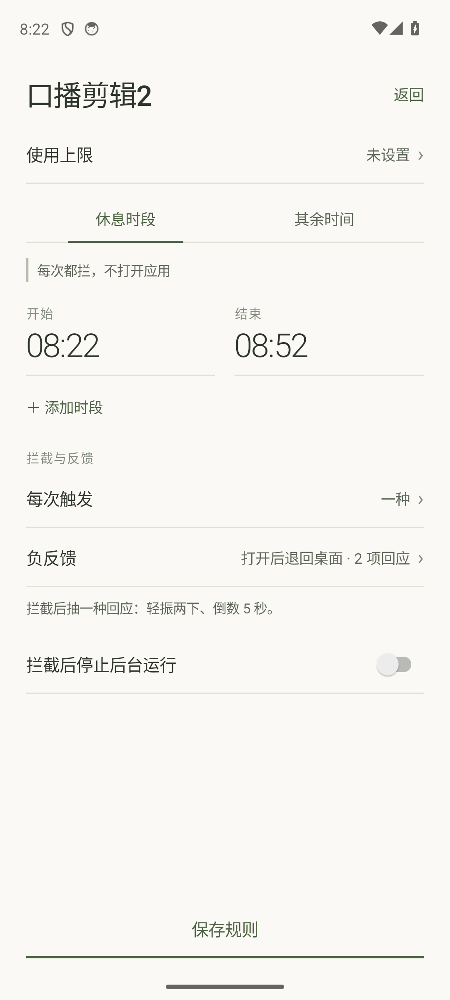
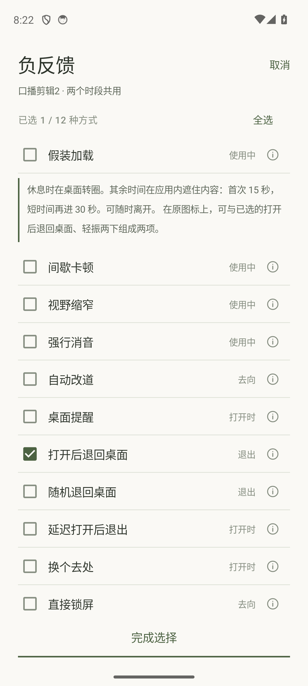
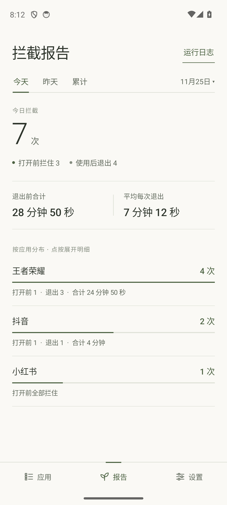
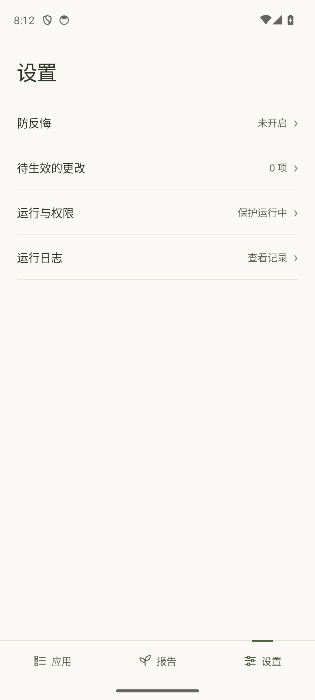

<div align="center">

# 反人性软件 · AppDodge

**用可控的「温和摩擦」打断肌肉记忆，而不是靠意志力和自己硬碰硬。**

保留你的 Android 原厂桌面 · 12 种反人性负反馈 · 24 小时防反悔冷静期 · 纯本机离线运行

-3d5a4c?style=flat-square)


**简体中文** · [English](README_EN.md)

</div>

---

## 为什么做「反人性软件」？

大多数手机自控软件都在和人性正面硬刚：要么一刀切彻底锁死，逼得你烦躁之下直接把它卸载；要么要求你换掉顺手的原厂桌面、注册账号、把使用记录传到云端。

**消费级 App 让人停不下来的秘诀，是「零延迟 + 丝滑体验 + 随机爽感」。**
AppDodge 反其道而行之：**既然它们用丝滑把你留住，我们就用恰到好处的“不太顺手”，把肌肉记忆轻轻绊一下。** 🪶

- 🛌 **午休不想碰游戏？** 设好休息时段，点原桌面图标直接拦住，从通知或最近任务偷偷溜进来也会被送回桌面。
- 🎲 **平时不想完全戒断，只想少刷一点？** 把日常概率滑到 30%——每次打开独立抽签：没抽中算你走运，正常玩；抽中了，可能先在转圈的假加载里干等 15 秒、可能画面慢慢缩成一条窄缝、可能突然消音或间歇卡顿、也可能刚上头就被随机送回桌面。
- 🧊 **怕自己一时上头关掉规则？** 开启 **24 小时冷静期**和**管理时段**——想删规则、想暂停保护？行，明天这个时候才生效，等明天的你大概率已经冷静下来了。

> 我们的底线是**打断顺手点开，不把伤害当作强度**：不做刺耳强声 🔇、不做高频闪屏 ⚡、不做羞辱式文案 🙅‍♂️——当然，如果你真的好这一口，反正已经 MIT 开源了，欢迎自己 fork 回去给自己加戏 😈。详见 [设计边界说明](docs/反馈篮-哪些反馈不该用.md)。

---

## 界面一览

纸墨风格的克制排版，零广告、零信息流、零焦虑红字。

<table>
  <tr>
    <td align="center"><br/><sub>休息时段与规则编辑</sub></td>
    <td align="center"><br/><sub>12 种反人性负反馈篮</sub></td>
    <td align="center"><br/><sub>拦截报告与退出前用时</sub></td>
    <td align="center"><br/><sub>防反悔与运行权限</sub></td>
  </tr>
</table>

---

## 核心特性

### 1. 保留原厂桌面，无需 Root、无需小组件
不需要更换第三方 Launcher，也不需要在桌面另摆替代图标。开启系统无障碍服务后，直接在你手机原本的桌面图标上识别拦截，同时接管从通知栏、最近任务等入口切入的全屏窗口。

### 2. 「休息时段 + 日常概率 + 使用上限」三轨并行
- **多段休息时段**：支持为每款应用添加多个休息区间，支持跨午夜；休息时段内一律拦截。
- **日常概率滑杆（0%～100%）**：非休息时间每次重新打开独立抽签，没抽中则正常使用，应用内翻页不重复打扰；想只限时、不抽签，滑到 0% 即可。
- **单次 & 单日使用上限**：例如「单次 30 分钟、单日 90 分钟、本轮用满休息 10 分钟」。切去回消息自动暂停计时，回来继续算剩余时间；额度独立于日常概率，可单独关闭休息时段只做限时。

### 3. 12 种负反馈 × 随机组合 × 5 种退出回应 🎭
每款应用拥有自己的一篮勾选，可设定每次抽取 **1 种** 或 **随机 2～3 种兼容组合**（绝不把锁屏和改道硬塞进同一次，按当前入口自动匹配可执行方式，主打一个“开盲盒式劝退”）：

| 反馈方式 | 抽中时的实际体验 |
| --- | --- |
| 🌀 **假装加载** | 休息时在桌面转圈；其余时间用无文字无倒计时的加载画面遮住内容区（首次 15 秒，短时重进 30 秒），沉浸式重温 2G 网速，不改变真实网络，随时可退。 |
| 🧊 **间歇卡顿** | 先正常使用 3～6 秒，随后冻结内容区触摸 4～6 秒，交替循环；短时间重进直接从冻结开始，专治越滑越快的手指。 |
| 🎞️ **视野缩窄** | 上下黑边在 20～40 秒内缓缓合拢成一条窄缝，不禁止触摸，离开即撤；短时重进续接上次进度，不白送新全屏。 |
| 🔇 **强行消音** | 目标在前台时静音媒体声道，手动调高也会被再次压回；离开后自动恢复原音量，不影响铃声、闹钟与通话。 |
| 🎲 **随机退回桌面** | 自选 `0～1 分钟` 或 `3～10 分钟` 档，抽中本轮可用前台时间（切走暂停、5 分钟内回来续计），可选退出前最后几秒画面收拢。 |
| ⏳ **延迟打开后退出** | 先在桌面老实等 10 秒，随后 1 分钟内再点图标进入；真正进去 1～2 秒后，礼貌送回桌面。 |
| 🚪 **打开后退回桌面** | 进入应用确认全屏后即送回桌面；若搭配了使用中反馈，则等效果生效后再请出。 |
| 🔀 **自动改道** | 点原图标时直接打开你预设的备选应用（比如想刷短视频，手一滑跳进了电子书或待办）。 |
| 🧭 **换个去处** | 留在桌面弹出备选应用入口，给大脑一个岔路口，由你决定去不去。 |
| 🔒 **直接锁屏** | 点中原图标后直接锁住整部手机，不是盖一张假黑图，物理冷静。 |
| ⏱️ **延时锁屏** | 点中原图标不启动应用，停在桌面 5～10 秒后锁屏；中途离开原桌面自动取消。 |
| 💬 **桌面提醒** | 直接在原桌面图标上挡住并给出轻反馈。 |

拦住或退回桌面后，还可搭配 **轻振两下**、**倒数 5 秒**、**显示本轮用时**、**休息提醒** 或原图标 **再点锁屏**（看见提示停手片刻再点同一图标才锁屏，防误触也防头铁）。

### 4. 三重「防反悔」机制
- **24 小时冷静期**：开启后，修改或删除规则、暂停保护、变更管理时段、关闭冷静期本身，全部先进入预约队列，**满 24 小时才生效**；等待期间原规则照常执行，随时可在原行撤回。
- **管理时段**：给反人性软件自己设一个每天的开放窗口（例如 `20:00–20:15`）。其余时间连设置页本身都打不开，只提示下次开放时间，且不设应急后门密码。
- **15 分钟临时规则锁**：不想开全天冷静期时，一键把规则暂时锁住 15 分钟。

### 5. 拦截报告与逐次日志
底部「报告」页按 **今天 / 昨天 / 指定日期 / 累计** 展示总拦截次数，清晰区分「打开前拦住」与「使用后退出」，并统计退出前合计与平均用时。**查看报告无需「使用情况访问」权限**（仅在希望给单日上限补齐保护启动前已用时长时可选授权）。

### 6. 可选：退回桌面后静默停止后台（免 Root）
默认只把应用退回桌面；如果希望游戏或视频退回后不再挂在后台，可为单款应用开启「拦截后停止后台运行」。
- **内置本机无线配对**：无需另装管理器，首次在 Wi-Fi 下通过系统「无线调试」输入 6 位配对码即可建立本机 `127.0.0.1` 加密连接（密钥存于 Android Keystore，配对码不写日志不落盘）。
- **兼容 Shizuku**：已安装并授权 Shizuku v13+ 时可直接沿用。
- 只针对**本次由规则自动退回**的目标生效；你自己切走、正常放行或手机重启断连后均不会误杀或补杀。

---

## 和常见防沉迷 / 专注软件有什么不同？

如果你在找一款 **开源、免费、免 Root、离线、不换默认桌面** 的 Android 防沉迷工具（比如 *one sec*、*AppBlock*、*Minimalist Phone* 或系统自带数字健康的替代品），下面是客观定位对照：

| 维度 | 反人性软件（AppDodge） | 传统锁机 / 商业防沉迷 | 极简桌面替代类（Launcher） |
| --- | --- | --- | --- |
| **桌面形态** | 保留手机原厂桌面，直接守在原图标上 | 多为打开后弹全屏遮罩 | 必须替换整个手机默认桌面 |
| **干预方式** | 12 种温和负反馈 + 0%～100% 随机概率 + 组合抽签 | 固定倒计时或一刀切禁开 | 靠黑白文字界面降低点击欲 |
| **防反悔机制** | 24 小时冷静期预约 + 每日管理时段 + 15 分钟锁 | 付费严苛模式 / 密码锁 | 切回原桌面即可绕过 |
| **隐私与联网** | MIT 开源、零账号、零云端、无广告 | 多需订阅付费或含云端统计 | 部分需账号或订阅 |
| **杀后台（可选）** | 内置本机无线调试配对 / 兼容 Shizuku（免 Root） | 多数不支持或依赖复杂权限 | 通常不支持 |

### 常见问题（FAQ）

- **Q：需要 Root 或一直连着电脑吗？**
  不需要。所有核心拦截、12 种负反馈、使用上限、24 小时冷静期和管理报告都在手机本机独立运行，无需 Root、无需电脑、无需联网。只有可选的「退回桌面后静默停止后台」需要首次在 Wi-Fi 下配对本机无线调试（或使用已有 Shizuku）。
- **Q：会被用来偷看聊天记录或上传使用习惯吗？**
  不会。代码完全以 MIT 开源，无任何后端服务器、统计 SDK 或账号系统；无障碍权限只读取桌面图标位置和当前前台应用包名，不读取应用内部文字、聊天或通知内容。
- **Q：开了 24 小时冷静期或管理时段，后悔了怎么办？**
  24 小时冷静期内的修改随时可以撤回，只是生效必须等满 24 小时；管理时段内可正常修改设置。本应用尊重系统边界，不会锁死 Android 原生的撤销无障碍权限或卸载能力。
- **Q：支持哪些 Android 手机？**
  最低要求 Android 12（API 31）。桌面点前拦截依赖各家原生桌面暴露的无障碍节点；对无法在桌面定位图标的入口（或通知、最近任务切入），会自动走前台全屏确认后退回桌面。

---

## 隐私与能力边界

- **100% 本机运行**：无账号、无云同步、无统计埋点、无第三方广告 SDK。清单中的 `INTERNET` 权限**仅用于**可选停后台功能连接本机回环地址 `127.0.0.1` 发现并通信系统无线调试端口，不访问任何外部服务器。
- **不读取私密内容**：无障碍服务仅用于识别桌面图标位置与当前前台应用包名，不读取聊天记录、输入内容或通知正文。
- **诚实的技术边界**：
  - 依赖 Android 无障碍服务运行，若服务被系统关闭或后台冻结，保护会暂停；管理页提供显式状态提示与一键恢复入口。
  - 普通 APK 无法保证所有机型都在应用第一帧出现前拦住；不同厂商桌面暴露的图标节点不同，只对能明确识别的原图标做点前拦截，不盲猜坐标。
  - 保留 Android 系统原生的撤权与卸载能力，不会劫持或变砖设备。

---

## 安装与从源码构建

### 运行环境要求
- **手机端**：Android 12（API 31）及以上。
- **构建环境**：Python 3、JDK 17、Android SDK Platform 35 与 Build Tools `35.0.0`。

### 一键离线构建（推荐）

仓库内已随附离线编译所需的全部固定版本客户端依赖（详见 [THIRD_PARTY_NOTICES.md](THIRD_PARTY_NOTICES.md) 与 [app/libs/localadb/README.md](app/libs/localadb/README.md)），无需配置代理或等待 Gradle 下载，直接调用 SDK 工具链即可完成构建与自检：

```sh
# 按需指定环境变量（macOS 默认自动探测 Homebrew JDK 17 与 ~/Library/Android/sdk）
# export JAVA_HOME=/path/to/jdk-17
# export ANDROID_SDK_ROOT=/path/to/android-sdk

# 1. 构建 APK（输出至 output/ 并附带 SHA-256 校验文件）
python3 scripts/build.py

# 查看生成的 APK 路径
python3 scripts/build.py --apk-path

# 2. 运行本地规则单元测试
sh scripts/test.sh

# 3. 可选：在已开启无障碍服务的独立 Android 模拟器上运行设备测试
sh scripts/device-test.sh emulator-5554
```

> 仓库也保留了标准 Gradle 工程配置（Gradle 8.9 / AGP 8.7.3），可用 Android Studio 打开阅读和调试；发布构建以 `scripts/build.py` 为准。首次本机构建会自动生成 `build/debug.keystore`，保留该密钥即可在自己的手机上持续原位覆盖升级。

---

## 目录结构

```text
.
├── app/
│   ├── src/main/java/dev/local/appdodge/   # 核心规则、原桌面保护、12 种负反馈、额度与本地报告
│   ├── src/main/assets/notices/            # 随 APK 打包的 14 份第三方开源许可声明
│   └── libs/                               # 离线构建所需的本机配对与 Shizuku 客户端依赖
├── scripts/                                # 离线 APK 构建脚本、本地测试与模拟器回归入口
├── tests/                                  # 策略单元测试、无障碍状态机单测与模拟器 UI 回归用例
├── docs/                                   # 设计边界说明与精选界面截图
├── THIRD_PARTY_NOTICES.md                  # 第三方组件来源、变更与许可清单
└── LICENSE                                 # MIT 开源许可证
```

---

## 开源许可

本项目自身源代码基于 [MIT License](LICENSE) 开源。
仓库内嵌与随 APK 分发的第三方组件（Gradle Wrapper、Shizuku-API、AndroidX Annotation、libadb-android、Conscrypt、Bouncy Castle、spake2-android）各自遵循其原始开源协议，完整来源、修改说明与源码重链接方式见 [THIRD_PARTY_NOTICES.md](THIRD_PARTY_NOTICES.md) 与 [app/libs/localadb/README.md](app/libs/localadb/README.md)。
