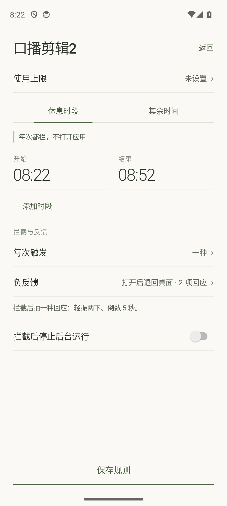
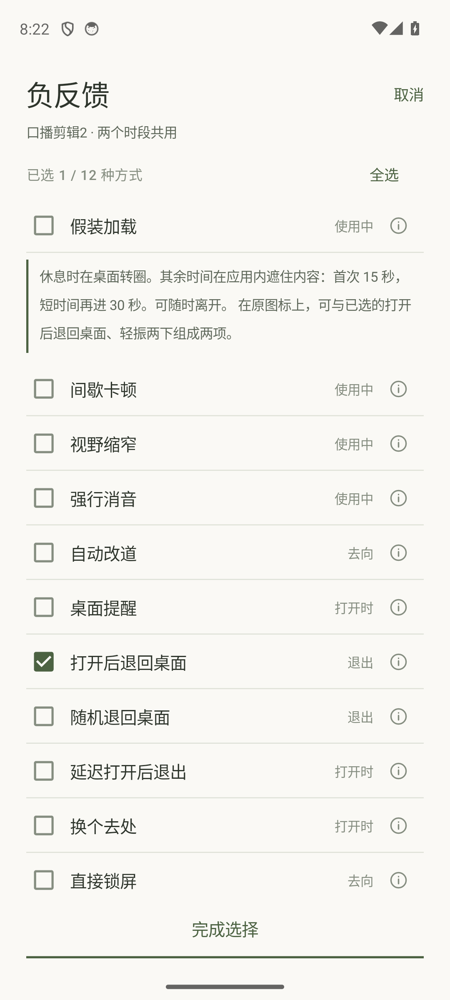
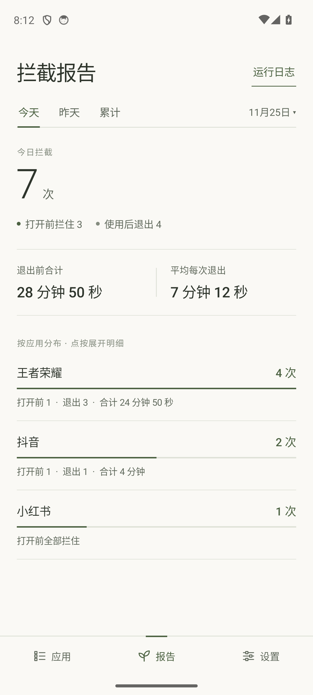
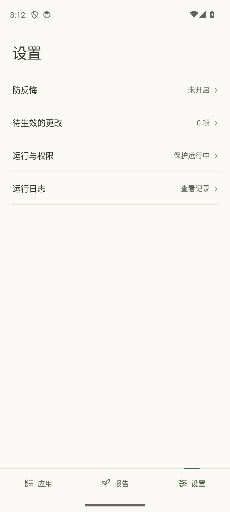

<div align="center">

# AppDodge (反人性软件)

**Break reflexive phone habits with controllable, mindful friction — instead of fighting willpower head-on.**

Keep your stock Android launcher · 12 mindful friction effects · 24-hour anti-relapse cooldown · 100% offline & open source

-3d5a4c?style=flat-square)


[简体中文](README.md) · **English**

</div>

---

## What Is AppDodge?

**AppDodge** is a free, open-source, offline-first **Android app blocker & digital wellbeing tool** (an open-source, stock-launcher alternative to *one sec*, *AppBlock*, or *Minimalist Phone*).

Most screen-time blockers rely on hard locks that push you to uninstall them in frustration, or force you to replace your default Android home screen. Consumer apps hook you with zero-latency smoothness and variable rewards — AppDodge flips that mechanism by introducing **unpredictable, gentle friction** right on your existing launcher icons and app sessions:

- 🛌 **Rest Schedules**: Strictly block selected distracting apps during chosen time windows (multiple intervals, overnight supported) across home icons, notifications, and recents.
- 🎲 **Daily Probability Slider (0%–100%)**: Outside rest hours, roll an independent probability check each time you open an app. Pass the roll and use it normally; hit the roll and trigger 1 or a random 2–3 combination of friction effects.
- ⏱️ **Session & Daily Usage Caps**: Set per-session limits, daily caps, and mandatory cool-off breaks between rounds without requiring Usage Access permission for basic reporting.
- 🧊 **Anti-Relapse Protection**: Enable a **24-hour cooldown** (any edit, deletion, or pause waits 24 hours before taking effect), a **daily management window** (settings can only be opened during a chosen time slot, e.g., `20:00–20:15`), or a **15-minute rule lock**.
- 🪶 **No Harm as Intensity**: No loud alarms, no rapid flashing screens, no shaming copy. (And if you really want snarky prompts — it's MIT licensed, feel free to fork your own chaos 😈.)

---

## Screenshots

<p>Clean paper-and-ink UI — zero ads, zero accounts, zero analytics. (Currently localized in Simplified Chinese.)</p>

<table>
  <tr>
    <td align="center"><br/><sub>Schedules & Rule Editor</sub></td>
    <td align="center"><br/><sub>12 Mindful Friction Effects</sub></td>
    <td align="center"><br/><sub>Block Report & Pre-Exit Time</sub></td>
    <td align="center"><br/><sub>Anti-Relapse & Permissions</sub></td>
  </tr>
</table>

---

## 12 Mindful Friction Effects

Each app has its own basket of friction effects and post-exit responses (haptic double-tap, 5s countdown, session duration summary, rest reminder, or double-tap-to-lock):

| Friction Effect | Behavior When Triggered |
| --- | --- |
| 🌀 **Fake Loading** | Shows a plain spinner (15s first time, 30s on quick re-entry) without touching your network. |
| 🧊 **Intermittent Freeze** | Alternates 3–6s normal use with 4–6s touch-frozen content area. |
| 🎞️ **Tunnel Vision** | Smoothly narrows top/bottom bars into a thin slit over 20–40s; resumes progress on quick re-entry. |
| 🔇 **Forced Media Mute** | Mutes media volume while the target app is foregrounded; restores automatically on exit. |
| 🎲 **Random Exit to Home** | Grants a random foreground allowance (`0–1 min` or `3–10 min`), pauses when you switch away, optionally narrows before exit. |
| ⏳ **Delayed Open Then Exit** | Wait 10s on home screen before opening, then automatically return to Home 1–2s after entry. |
| 🚪 **Open Then Exit** | Returns to Home once fullscreen entry is verified (or after paired in-app effects take hold). |
| 🔀 **Auto Redirect** | Launches a pre-chosen healthier alternative app (e.g., e-reader or notes) from the original icon. |
| 🧭 **Suggest Alternative** | Stays on Home and offers a quick button to your chosen alternative app. |
| 🔒 **Instant Lock** | Locks the device screen directly upon tapping the guarded icon. |
| ⏱️ **Delayed Lock** | Keeps you on Home and locks after 5–10s (cancelled if you navigate away). |
| 💬 **Desktop Reminder** | Blocks directly on the original home icon with your chosen gentle response. |

### Optional: Silent Force-Stop After Exit (No Root)
By default, AppDodge simply returns distracting apps to Home. For apps you also want completely stopped in the background after a rule-triggered exit, AppDodge includes **built-in on-device Wireless Debugging pairing** (`127.0.0.1`, TLS key stored in Android Keystore) and also supports **Shizuku v13+**. Manual Home presses or normal passes never trigger a force-stop.

---

## Privacy & Boundaries

- **100% Local & Offline**: No accounts, no cloud sync, no telemetry, no ad SDKs. `INTERNET` permission is strictly used for localhost (`127.0.0.1`) Wireless Debugging pairing when you opt in to silent background stopping.
- **No Content Reading**: The Accessibility Service only detects launcher icon bounds and active foreground package names; it never reads chats, inputs, or notification text.
- **System Respect**: Android's native permission revocation and uninstall flows remain untouched.

---

## Build From Source (Offline-Ready)

Requires **Python 3**, **JDK 17**, **Android SDK Platform 35**, and **Build Tools `35.0.0`** (targets **Android 12 / API 31+**). All pinned client libraries are vendored for reproducible offline builds (see [THIRD_PARTY_NOTICES.md](THIRD_PARTY_NOTICES.md)):

```sh
python3 scripts/build.py            # Build signed debug APK into output/ + SHA-256
python3 scripts/build.py --apk-path # Print generated APK path
sh scripts/test.sh                  # Run policy & schedule unit tests (24,220 checks)
```

Standard Gradle files (`Gradle 8.9` / `AGP 8.7.3`) are also included for Android Studio.

---

## License

AppDodge's own source code is released under the [MIT License](LICENSE). Third-party libraries retain their respective licenses; see [THIRD_PARTY_NOTICES.md](THIRD_PARTY_NOTICES.md) and [app/libs/localadb/README.md](app/libs/localadb/README.md).
